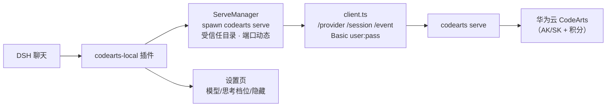

# DSH-HUAWEI-CodeArt2API 正式设计（路径 A：复用 codearts serve）

> 版本：v1 设计稿｜日期：2026-11-22
> 依据：[`_temp/report.md`](report.md)（实测）、[`_temp/probe/gap-report.md`](probe/gap-report.md)（差异清单）、[`_temp/target.md`](target.md)/[`_temp/plan.md`](plan.md)
> 参照实现：`D:\DSH-Opencode2API-hbk\plugin`（`@hbk/dsh-opencode-local` 0.2.8-3，已验收）
> 说明：本设计**只面向路径 A**（保底方案，已定）。路径 C（直连模型 API）已验证受阻，见 report.md 第九节。

---

## 1. 目标与范围

**做什么**：一个 DSH 的 cordis 插件，把本机 `codearts serve` 通道接入 DSH，让 DSH 能选用华为云码道的模型。

**不做什么**：
- 不做对外 OpenAI 兼容 API（人工裁决关闭）。
- 不改 CodeArts 任何文件、不碰其凭据明文、不提交 git。

**一句话架构**：DSH ←(LlmAdapter)→ 插件 →(HTTP/SSE，Basic)→ 本机 `codearts serve` →(华为云上游)→ CodeArts 模型。



---

## 2. 插件元信息与安装

| 项 | 值 |
| --- | --- |
| 包名 | `@hbk/dsh-codearts-local` |
| provider id | `codearts-local` |
| 数据目录 | `~/.dsh-codearts-local/`（catalog 缓存、serve.log、运行时状态） |
| 端口基址 | **4196**（占用则 +1，扫描 16 个） |
| 安装 | `dsh plugin --profile web add <tgz>`（实测可用）；装后完全退出并重启 DSH |
| patch | `cordis.patch.yml` 的 `insert` 行（id/name/config） |

---

## 3. 目录结构（plugin/）

```
plugin/
  package.json
  cordis.patch.yml
  src/
    index.ts                 # 入口（复用结构）
    config.ts                # 配置 schema + live 读取
    types.ts                 # 类型（扩展 CodeArts 事件）
    priority.ts              # 活动计数（复用）
    serve/
      manager.ts             # 进程管理（改造）
      client.ts              # HTTP/SSE 客户端（重写）
    catalog/
      models.ts              # 模型目录（重写解析）
    adapter/
      local-adapter.ts       # LlmAdapter（改造）
      turn.ts                # 回合执行（改造）
      translate.ts           # 事件→chunk（重写）
      flatten.ts             # 历史压平（复用，微调）
    web/
      routes.ts              # 设置页路由（复用，改路径/文案）
```

---

## 4. 模块设计与改造清单（before → after）

### 4.1 `serve/manager.ts`（进程管理）— 改造

**职责**：按需拉起 `codearts serve`，保活、重启、销毁。

| # | before（opencode 版） | after（CodeArts 版） |
| --- | --- | --- |
| 1 | `spawn('opencode', ['serve','--hostname','127.0.0.1','--port',port])` | `spawn('codearts', ['serve','--hostname','127.0.0.1','--port',port])` |
| 2 | env `OPENCODE_PASSWORD=<随机>` | env `CODEARTS_SERVER_USERNAME=<随机短名>` + `CODEARTS_SERVER_PASSWORD=<随机>`（两者必填） |
| 3 | cwd = 默认（继承） | cwd = **受信任目录**（默认 `os.homedir()`，可配 `workingDirectory`）；否则 CLI 报「文件夹未被信任」 |
| 4 | 就绪探测 `GET /api/info`（200） | 就绪探测 **`GET /config`**（200）；辅以日志 `server listening on` |
| 5 | 端口基址 4096 | **4196**（4096 被常驻 opencode 占用） |
| 6 | 鉴权 Basic `opencode:<pw>` | Basic `<username>:<pw>`（用户名非固定） |
| 7 | 日志/心跳 `/api/info` | 心跳 `GET /config` |
| 8 | 无并发控制 | 新增：**并发会话信号量 ≤3**（见 §6.2） |

**保留**：`findFreePort` 扫描、单飞（inflight 去重）、心跳重启预算（maxRestarts=3）、Windows `taskkill /T /F` 杀树、 detached+unref。

### 4.2 `serve/client.ts`（HTTP/SSE）— 重写

**职责**：对 serve 的 REST + SSE 封装。

| # | before（`/api/*`） | after（实测 CodeArts，无 `/api` 前缀） |
| --- | --- | --- |
| 1 | `GET /api/model` → `{data:[...]}` | `GET /provider` → `{all:[{id,name,env,options,source,models}]}` |
| 2 | `GET /api/model/default` | 删除（改用 `/config.model` 或不设默认） |
| 3 | `POST /api/session {title,agent,model,permissions}` → `{data:{id}}` | `POST /session {title}` → `{id,...}`（model 在 prompt 时给；query 可传 `directory`） |
| 4 | `POST /api/session/:id/prompt {text}`（同步） | `POST /session/{id}/prompt_async {messageID,model{providerID,modelID},agent,variant?,parts:[{type:'text',text}]}` → **204** |
| 5 | `GET /api/event`（SSE） | `GET /event`（SSE，事件结构不同，见 §5） |
| 6 | `POST /api/session/:id/permission/:reqId/reply` | `POST /permission/{requestID}/reply` body `{reply:'once'\|'always'\|'reject'}` |
| 7 | （无） | `POST /question/{requestID}/reply` body `{answers:[...]}`（见 §6.4） |
| 8 | `POST /api/session/:id/interrupt` | `POST /session/{id}/abort` |
| 9 | `DELETE /api/session/:id` | `DELETE /session/{id}`（返回 `true`） |
| 10 | `GET /api/session` → `{data:[...]}` | `GET /session`（数组） |
| 11 | Basic `opencode:<pw>` | Basic `<username>:<pw>` |
| 12 | `GET /api/info`（就绪/版本） | `GET /config`（就绪） |

**通用**：`serveRequest(ep, method, path, body)` 保持（JSON + 状态码 + text）。

### 4.3 `catalog/models.ts` — 重写解析

| # | before | after |
| --- | --- | --- |
| 1 | `listModels()` 用 `/api/model` 的 `data[]` | 新增 `listProviders()` 用 `/provider` 的 `all[]`，展开 `models{}` |
| 2 | 过滤 `enabled === false` | 过滤 **`status !== 'active'`** |
| 3 | `free = cost 全 0` | **不做免费过滤**；改为记录 `creditRatioDisplay`（如 `0.18x`）供展示 |
| 4 | `capabilities.input[]` 字符串 | `capabilities.input{text,audio,...}` → 只要 `input.text===true` 即 `['text']` |
| 5 | `variants: [{id}]` | `variants: {low:{reasoningEffort},high,max}` → `['low','high','max']` |
| 6 | `limit.context/output` | 同名字段，沿用 |
| 7 | 模型 id = `m.id`（形如 `provider/model`） | id = **modelID**（如 `deepseek-v4.1-flash-1017`），providerID = `huaweicloud-maas` |
| 8 | 缓存到 `catalog.json` | 沿用（含 creditRatio 字段） |

### 4.4 `adapter/local-adapter.ts` — 改造

- 复用：`providerInfo/listModels/resolveModel/prepareCall/stream`、白名单、重试策略常量、诊断计数器。
- 改动：
  - `resolveModel` 的 `defaultMaxTokens` 取 `limit.output`（最大 65536），`contextWindow` 取 `limit.context`（最大 1M）。
  - `refOf` 支持 variant ∈ {low,high,max}。
  - `RETRY_POLICY.retryableCodes` 增加 `APIError`（华为云错误名，见 §5）与并发上限错误识别。
  - 去掉对外 API 相关（如有）。

### 4.5 `adapter/turn.ts` — 改造（回合执行）

**流程（无状态每回合）**：
1. `ensureReady()` 拿 endpoint。
2. `flattenHistory(options)` 或 `flattenCompaction(options)` 生成单条 text。
3. `POST /session {title}` 建会话，记录 `diag.sessions`。
4. 打开 `/event` SSE；**过滤条件**：仅接收 `properties.sessionID === 本会话` 的事件（含无 sessionID 的全局事件如 server.connected）。
5. `POST /session/{id}/prompt_async`（带 model/variant/parts）。
6. 泵事件：遇到 `permission.asked`（实测默认不触发）按策略回；遇到 `question.asked` 走 §6.4；终态 = `session.idle` / `session.error`。
7. 看门狗：首事件窗口 `firstEventMs`、空闲窗口 `idleMs`（沿用）。
8. `finally`：关 SSE；**可选 `DELETE /session/{id}`**（清理，避免堆积；见 §6.6）。
9. 中止：`options.signal` → `POST /session/{id}/abort`。

**变化点**：
- terminal 事件从 `session.execution.*` 改为 **`session.idle`/`session.error`**。
- 移除/改写 `permission.asked` 的数据结构（`properties.id`，不再有 `action`；serve 默认不触发）。
- 新增 `question.asked` 处理。

### 4.6 `adapter/translate.ts` — 重写（事件→DSH chunk）

| CodeArts 事件 | 含义 | 产出 HarnessChunk |
| --- | --- | --- |
| `message.part.updated` (part.type=`text`, role=assistant) | 文本块 | `block-start(text)` + 结束后 `block-end(text)` |
| `message.part.delta` (`field:'text'`) | 文本增量 | `text-delta(index,text)` |
| `message.part.updated` (part.type=`reasoning`) | 思考块 | `block-start(reasoning)` / `block-end(reasoning)` |
| `message.part.delta`（reasoning 若也有） | 思考增量 | `reasoning-delta` |
| `message.part.updated` (part.type=`tool`) | 工具调用 | 合成 note：`[工具] <tool> <input>`；完成 `[完成] <output>`；失败 `[失败] <error>`（作为 reasoning 块） |
| `message.part.updated` (`step-start`/`step-finish`) | 步骤 | 忽略或合成轻量 note |
| `message.updated` (info.role=assistant) | 用量/结束 | 缓存 `tokens` → 结束时 `usage` |
| `session.idle` | 正常结束 | `finish(stop)`（无文本则 `EMPTY_RESPONSE`） |
| `session.error` | 出错 | `finish(error)`，`classifyFailure` 识别 `APIError`/限流文案 |
| `tui.toast.show` | 提示 | 忽略（或调试日志） |

**索引映射**：以 `part.id`（或 `partID`）为 key 维护 part→block index，保证 delta 与 block 对齐。

### 4.7 `adapter/flatten.ts` — 复用（微调）

- 完全沿用「System + History + Current User Message」结构。
- 文案调整：工具策略恒为「工具在 CodeArts 侧沙箱内可用」（serve 默认），不再强调「无工具」。
- compaction 沿用。

### 4.8 `web/routes.ts` — 复用结构

- 路径前缀 `/plugins/codearts-local/*`（models / models/refresh / catalog / context）。
- 模型行新增 `creditRatio`（展示用），移除「free」语义。
- context 路由沿用（读 DSH 会话投影）。

### 4.9 `index.ts` — 复用结构

- 去掉对外 `ApiServer`（人工裁决关闭）。
- 其余（注册 adapter、settings.configure({auto:true})、web routes、dispose 管理）照搬。
- 启动时仍只做一次元数据刷新（不发模型请求）。

---

## 5. 接口映射总表（参照 opencode → CodeArts 实测）

| 用途 | 参照（opencode） | CodeArts 实测 |
| --- | --- | --- |
| 就绪/健康 | `GET /api/info` | `GET /config` → 200 |
| 列模型 | `GET /api/model` | `GET /provider`（`all[].models`） |
| 默认模型 | `GET /api/model/default` | `/config.model`（可选） |
| 建会话 | `POST /api/session` `{title,agent,model,permissions}` | `POST /session` `{title}` |
| 发消息 | `POST /api/session/:id/prompt` `{text}` | `POST /session/:id/prompt_async` `{messageID,model,agent,variant,parts}` → 204 |
| 事件流 | `GET /api/event` | `GET /event` |
| 权限回复 | `/api/session/:id/permission/:reqId/reply` | `/permission/{requestID}/reply` |
| 提问回复 | — | `/question/{requestID}/reply` |
| 中断 | `/api/session/:id/interrupt` | `/session/{id}/abort` |
| 删除 | `DELETE /api/session/:id` | `DELETE /session/{id}` |
| 鉴权 | Basic `opencode:<pw>` | Basic `<USERNAME>:<PASSWORD>` |
| 启动参数 | `--hostname/--port` | 同 + 必须 `CODEARTS_SERVER_USERNAME/PASSWORD` |

---

## 6. 关键机制

### 6.1 无状态每回合（强制）
- **每回合新建会话**，发完即结束；**不依赖 serve 的多轮上下文**（实测同会话连续 prompt 会丢事件/消息）。
- 全量历史由 `flatten.ts` 压进单条 prompt。
- 会话可选删除（§6.6），避免 `cli-data/opencode.db` 膨胀。

### 6.2 并发限流（强制 ≤3）
- 实测**体验版并发会话上限 3**，超出报 `APIError: 并发会话数已达上限(3个)`。
- 插件内维护**信号量（permits=3）**：`stream()` 进入时 acquire，`finally` release。
- 第 4 个请求**排队等待**（不立刻失败），或按配置返回可重试错误（`RATE_LIMIT`）。
- serve 的**进程本身单实例**，多个回合共用。

### 6.3 工具策略
- serve 端**默认 sandbox 自动执行**（实测 bash/edit/read/webfetch 等直接跑）。
- 实测 `config.permission.<tool> = deny` 可禁用工具；`ask` 与 allow 同效（不弹询问）。
- 插件提供配置项 `toolDeny: string[]`（默认空）：启动/刷新时通过 `PATCH /config {permission:{...}}` 下发（注意 **PATCH 是合并语义，只能覆盖不能删除**；因此只置 deny，不设 allow）。
- 若某工具被禁，模型会自动改用替代工具（实测），无需插件干预。

### 6.4 question（反问）处理
- serve 可能发 `question.asked`（实测模型主动提问时出现）。
- 默认策略：**自动回复空答案**（`{answers:[]}`）让流程继续，避免卡死 DSH。
- 可选策略（后续增强）：把问题转成 DSH 的交互（本期不做，先保证不卡）。

### 6.5 目录信任
- serve 必须从**受信任目录**启动（实测工作区不受信会拒绝）。
- Manager 的 spawn cwd 默认 `os.homedir()`，可配 `workingDirectory`。
- 会话 `directory` 参数默认不传（跟随 serve cwd）。

### 6.6 会话清理
- 每回合结束（拿到终态）后**默认删除会话**：`DELETE /session/{id}`。
- 提供开关 `keepSessions`（默认 false）；便于排查时保留。

### 6.7 重试与错误
- 重试码：`TRANSPORT` / `RATE_LIMIT` / `EMPTY_RESPONSE` / `SERVER`；最大 4 次，指数退避（1s→15s，抖动 20%）。
- `classifyFailure`：识别 429、`rate limit` 文案、`APIError`、并发上限文案（转为可重试 `RATE_LIMIT`）。
- 真实额度耗尽（如积分用完）**不重试**，如实上报。

### 6.8 就绪与心跳
- 启动：spawn → 轮询 `GET /config` 至 200（超时 60s）。
- 心跳：每 10s `GET /config`；失败按预算重启（maxRestarts=3）。

---

## 7. 配置项（config schema）

| 键 | 默认 | 说明 |
| --- | --- | --- |
| `providerId` | `codearts-local` | provider 名（全局唯一） |
| `codeartsPath` | `''`（自动找 `codearts`） | CLI 路径 |
| `workingDirectory` | `os.homedir()` | serve 启动目录（须受信任） |
| `portBase` | `4196` | 端口基址，占用 +1 |
| `titlePrefix` | `dsh-codearts-` | 会话标题前缀 |
| `thinkingVariant` | `''`（默认档） | 可设 `low/high/max` |
| `hiddenModels` | `[]` | 隐藏模型 |
| `modelWhitelist` | `[]` | 白名单（空=全部） |
| `toolDeny` | `[]` | 需禁用的工具（映射到 `config.permission`） |
| `concurrency` | `3` | 并发上限（体验版 3） |
| `keepSessions` | `false` | 是否保留会话 |
| `firstEventMs` / `idleMs` | 30000 / 120000 | 看门狗窗口 |

---

## 8. 设置页（web routes）

前缀 `/plugins/codearts-local/`：
- `GET /models`：模型列表（id/name/contextWindow/maxOutput/inputModalities/variants/creditRatio/hidden）。
- `POST /models/refresh`：刷新目录。
- `GET /catalog`：跨 provider 汇总（沿用参照逻辑）。
- `GET /context?sessionId=`：上下文压力（沿用参照逻辑）。

---

## 9. 打包与部署

1. `npm pack` 生成 `@hbk/dsh-codearts-local-<version>.tgz`。
2. `dsh plugin --profile web add <tgz>`（实测幂等可用）。
3. 确认 web profile 的 `package.json` 依赖 + `dsh.profile.bundles` 含该包。
4. **完全退出并重启 DSH**。
5. 运行期：插件自建 `~/.dsh-codearts-local/`，复用 `~/.codeartsdoer/cli-data`（凭据/会话），**不复制、不外发**。

---

## 10. 实现里程碑

| 阶段 | 内容 | 出口 |
| --- | --- | --- |
| M1 | 骨架 + config + manager（起 `codearts serve`、就绪、心跳） | 能起服务、`/config` 200 |
| M2 | client 重写（provider/session/prompt_async/event） | 单回合文本对话跑通 |
| M3 | translate + turn（无状态、终态、usage、abort） | 流式文本/思考正常 |
| M4 | catalog + adapter + settings/web | 模型可选、设置页可见 |
| M5 | 并发限流 + 工具 deny + question 兜底 + 清理 | ≤3 并发、不卡死 |
| M6 | 打包 + 真机联调（DSH 内对话/切模型/思考档） | 验收 |

---

## 11. 风险与验证点

| 风险 | 应对 |
| --- | --- |
| 接口契约漂移 | 以实现时 `codearts generate` 的 OpenAPI 为准；translate 层按实测事件类型做兼容判断 |
| 并发上限变化（标准版 5） | `concurrency` 可配；从错误文案动态识别 |
| 凭据过期导致 serve 不可用 | serve 自身负责刷新；插件启动失败时如实报错，不伪造 |
| 目录信任变更 | `workingDirectory` 可配；失败提示信任问题 |
| 工具在 CodeArts 侧执行（非 DSH） | 明确记录；如需「工具归 DSH」，另评估 MCP 桥接 |
| 会话膨胀 | 默认删会话 |

---

## 12. 与参照项目的复用度小结

| 模块 | 复用度 |
| --- | --- |
| index / priority / flatten / web 结构 / settings 接入 | **高**（照搬） |
| manager | 高（改命令/env/cwd/就绪/端口） |
| local-adapter | 中（改 retry/model 字段） |
| client | **低**（重写路径与请求体） |
| translate | **低**（按实测事件重写映射） |
| catalog | **低**（重写解析） |
